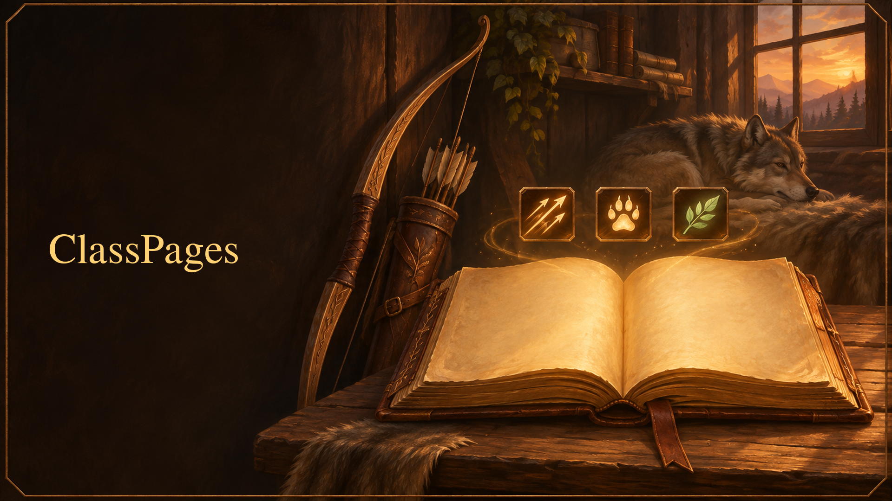

# ClassPages

ClassPages is an addon for **World of Warcraft: Forever**. It gives every class one window with everything that belongs to it (talent planner, trainer overview, class guides, the hunter's pet book) and a HUD you build yourself: your own action bars with cooldown timers, a flash when an ability is ready and a glow when a reactive ability can be used.

## What it does

### Class window (`/cp`)

- **Overview:** level, talent split, the next planned talent point and class cards.
- **Talents:** plan all three trees, save several plans, export and import them as text. The plan is ordered by level, so the window and a chat line at level-up tell you which point comes next.
- **Trainer:** after one visit to your class trainer, a list of what you can learn now, in the next two levels and later, with costs.
- **Class pages for all nine classes:** class quests, items worth getting and useful professions, filtered by level, with a live status (owned, learned, done). Hunters get the tameable beasts worth catching per level.
- **Pets (hunter):** the active pet with happiness, loyalty and training points, the stable and the learned beast training.
- **HUD:** the editor for your bars (see below).

### Your own action bars

- **Any number of bars** with free grid, button size, spacing, scale, opacity and position. Drag spells, items and macros onto them.
- **Class presets** create ready-made bars from the spells you know: shots, melee, traps and pet for hunters; main abilities, professions, pet and stances for every class.
- **Timers and highlights per bar:** cooldown swipe, a flash when the cooldown ends, a glow while a reactive ability is usable (Counterattack, Mongoose Bite), proc glow, range tint, and counters for items, reagents and ammunition that turn orange when low.
- **Visibility rules:** only in combat, only with a target, only in one stance or form, or fade in on mouseover.
- **Pet bar** with a gold frame for the active action, corner marks for abilities that can autocast and a pulsing frame while autocast is on. Right click toggles autocast.
- **Edit mode (`/cp unlock`):** drag bars with snapping, resize the grid at the corner, change values in a small popover.
- **Key bindings:** `/cp keys`, hover a button, press a key. One click on "Keys 1–0" gives a bar the keys of the main bar. Bindings are saved with the bar and never change the game's own key settings.
- **Hide game bars:** hides the game's main action bar. Its pet and stance bars are hidden only while one of your own bars holds those buttons. In a vehicle or while you control another unit, the game's bars and keys take over on their own.

## How it behaves

- **No automation.** Spells are cast only by your click or key press. Timers and events only update what is shown.
- **Built for combat restrictions.** On WoW: Forever, cooldowns and usability are hidden from addons in combat ("secret values"). ClassPages hands such values to the game's own widgets and never calculates with them. Changes to bars that are not allowed in combat are applied when combat ends.
- **Your settings are never reset.** Changes to the saved data are additive migrations, and a backup is written before each one and before every delete (`/cp backup`, `/cp restore confirm`). Profiles can be shared between characters.
- **Nothing leaves your computer.** The addon stores only your own settings, plans and pets.
- **English and German,** switchable in the window header.
- **Optional:** [Masque](https://www.curseforge.com/wow/addons/masque) skins the bar buttons when it is installed. No other addon is required.

## Commands

| Command | What it does |
|---|---|
| `/cp` | open or close the class window (`/classpages` works too) |
| `/cp unlock`, `/cp lock` | start and end the edit mode for bars |
| `/cp keys` | bind keys to bar buttons |
| `/cp talents` | open the talent planner (`dump`, `reload` for troubleshooting) |
| `/cp profile` | show, switch, copy or reset HUD profiles |
| `/cp backup`, `/cp restore confirm` | copy all data into the backup slot, restore it (`restore migration` for the backup written before the last data migration) |
| `/cp minimap` | show or hide the minimap button |
| `/cp feature` | list features or switch one on or off |
| `/cp debug` | self test with a report you can copy |
| `/cp probe` | measure which values the client lets addons read (run once out of combat and once in combat) |

## Installation

Install it with the CurseForge app, or unpack the zip so that the folder `ClassPages` lies in `World of Warcraft\_forever_\Interface\AddOns`. The addon loads on WoW: Forever only.

## Reporting a problem

Run `/cp debug`, copy the report and attach it to your issue. If something looks wrong in combat, add the output of `/cp probe` from a fight.

## Development

- `tools\check.ps1` (Windows) or `tools/check.sh` (CI) runs the Lua syntax check, luacheck, the unit tests and a session simulator that loads the whole addon, plays through logins of several characters and checks the layout of every tab in English and German. It must end with `CHECK OK`.
- `tools\preview.ps1` renders every tab from the real layout as an image, without the game.
- `tools\package.ps1 -Version 1.0.0` builds the zip for a manual upload. Tagged releases are built by the BigWigs packager (`.pkgmeta`, `.github/workflows/release.yml`).
- Concept, architecture, class page format and design rules are in `docs/` (German).

## Credits and licence

ClassPages is released under the [MIT licence](LICENSE).

It embeds these libraries unchanged (see `ClassPages/Libs/README.md`):

- [LibActionButton-1.0](https://github.com/Nevcairiel/LibActionButton-1.0) by Hendrik "nevcairiel" Leppkes, BSD 3-clause
- [CallbackHandler-1.0](https://github.com/WoWUIDev/Ace3) by the Ace3 team, BSD
- LibStub, public domain

The interface graphics in `ClassPages/Media` are drawn by a script in this repository (`tools/assets/make_assets.py`). The icon and the banner were created with an AI image generator for this project and contain no game artwork.

World of Warcraft is a trademark of Blizzard Entertainment. This project is not affiliated with or endorsed by Blizzard Entertainment.
